# TP2 — Déploiement d'un portfolio Next.js avec Coolify et Forgejo

Déploiement entièrement local, sans domaine DNS ni GitHub : **Forgejo** héberge le dépôt Git, **Coolify** construit et expose
l'application derrière **Traefik**, et un **webhook** Forgejo → Coolify redéploie automatiquement l'application à chaque `git push`.

| Service | Adresse |
|---|---|
| Coolify (dashboard) | http://192.168.190.155:8000 |
| Forgejo (web / SSH) | http://192.168.190.155:3001 — port SSH 2222 |
| Portfolio | http://portfolio.coolify.local |

VM : Ubuntu 24.04, IP **192.168.190.155** (utilisée à la place de 192.168.56.10 de l'énoncé).
Nom d'hôte local ajouté sur le poste Windows dans `C:\Windows\System32\drivers\etc\hosts` :

```
192.168.190.155  portfolio.coolify.local
```

## Architecture

```
Poste Windows ── git push ──► Forgejo :3001 ── webhook (push, secret) ──► Coolify :8000
      │                                                                     │ clone + build Nixpacks
      └── http://portfolio.coolify.local ──► Traefik :80 ──► conteneur Next.js :3000
```

---

## Partie A — Installation de Coolify

```bash
curl -fsSL https://cdn.coollabs.io/coolify/install.sh | sudo bash
docker ps
```

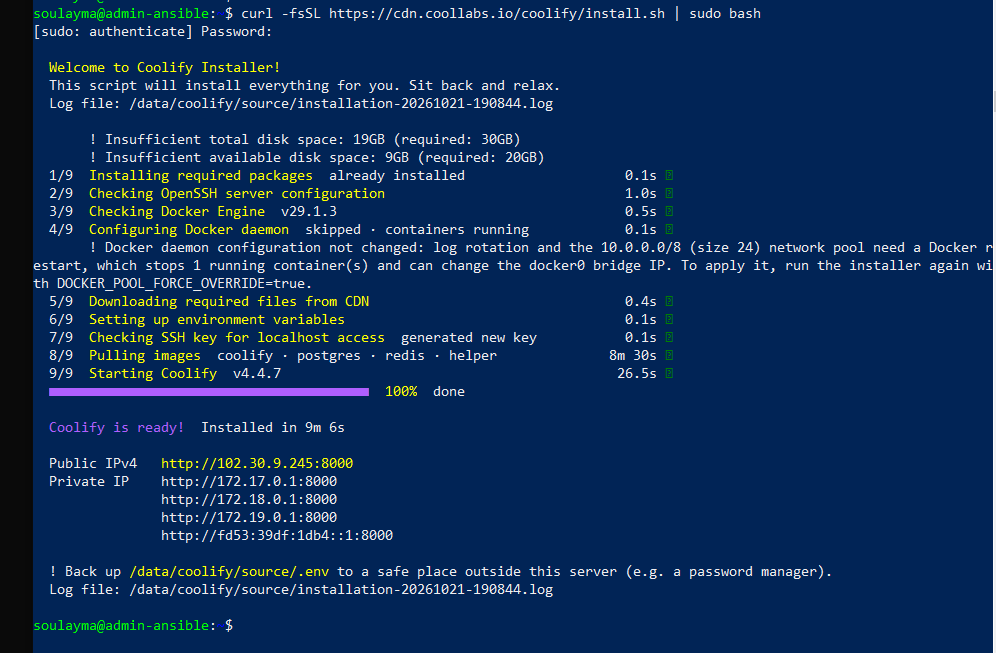

Compte administrateur créé, serveur `localhost` connecté (« This machine »), proxy Traefik démarré :

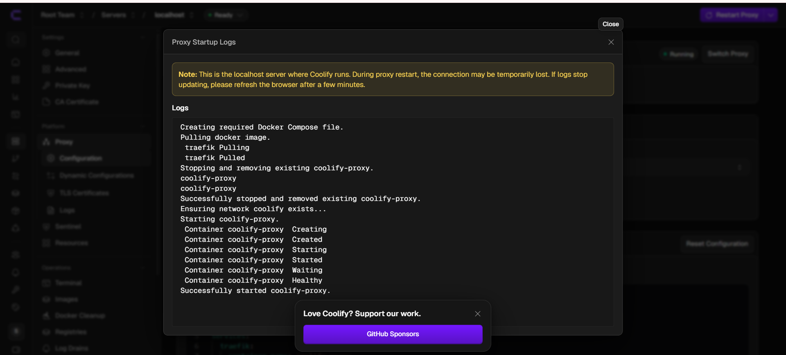

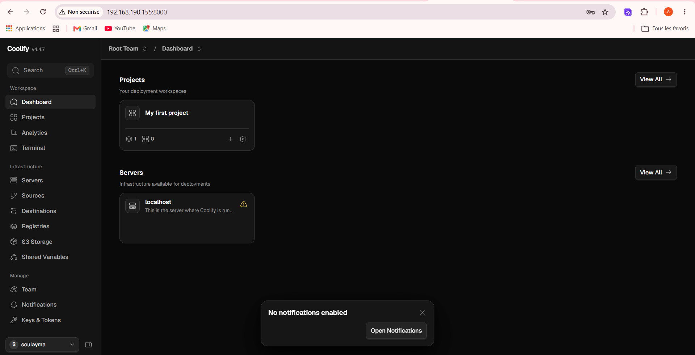

## Partie B — Forgejo et dépôt du portfolio

Forgejo est lancé avec [`forgejo/docker-compose.yml`](forgejo/docker-compose.yml) :

```bash
cd forgejo
docker compose up -d
docker ps          # conteneur « forgejo » Up
```

Points importants du fichier :
- port web **3001** (le 3000 est réservé à Next.js) et SSH **2222** ;
- `FORGEJO__webhook__ALLOWED_HOST_LIST=external,private` : sans ce réglage, Forgejo refuse d'envoyer un webhook vers une IP privée.

Configuration initiale : SQLite3, domaine `192.168.190.155`, URL de base `http://192.168.190.155:3001/`.

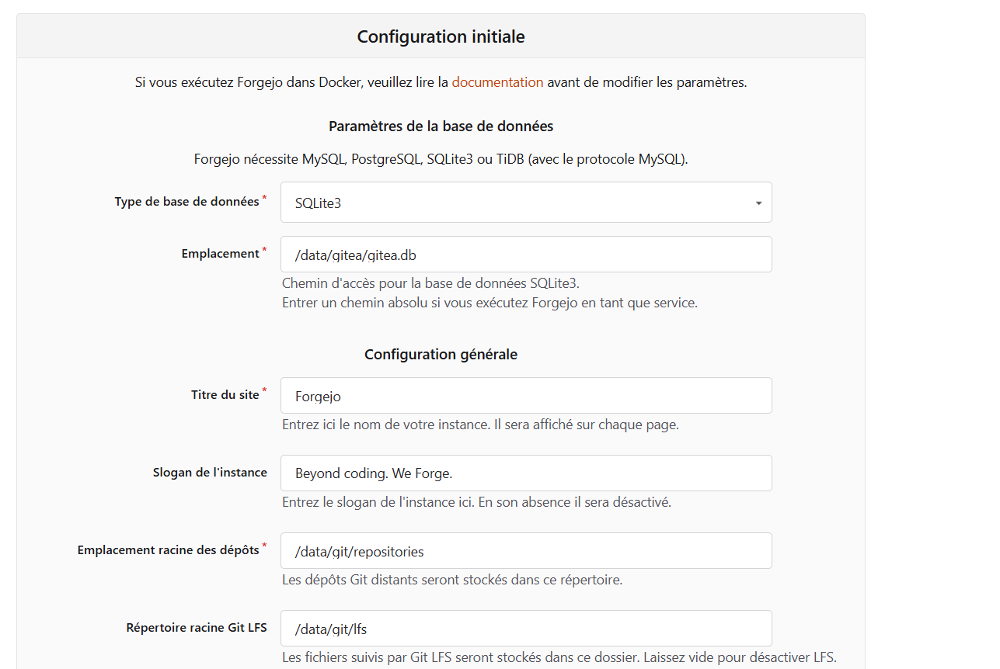

Création du dépôt public `portfolio`, puis envoi du code :

```bash
git remote add forgejo http://192.168.190.155:3001/soulayma/portfolio.git
git push -u forgejo main
```

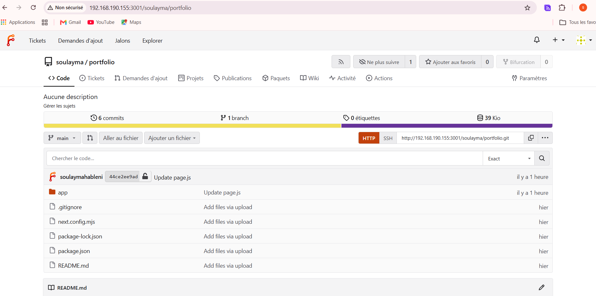

## Partie C — Déploiement du portfolio

| Étape | Dans Coolify | Valeur |
|---|---|---|
| 1 | Projects → Add | `portfolio`, environnement `production` |
| 2 | + Add Resource | Public Git Repository |
| 3 | Repository URL | `http://192.168.190.155:3001/soulayma/portfolio.git` (IP, pas de nom d'hôte) |
| 4 | Configuration | Branche `main`, Build Pack **Nixpacks** |
| 5 | Ports Exposes | `3000` |
| 6 | Domains | `http://portfolio.coolify.local` (protocole http, redirection HTTPS désactivée) |
| 7 | Deploy | Suivi des logs en direct |

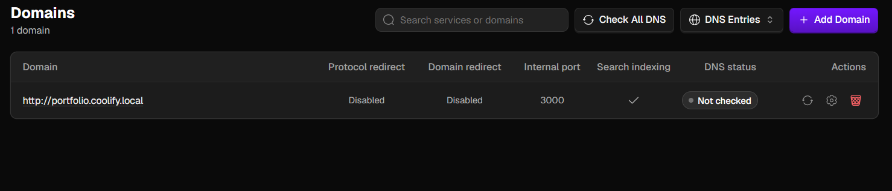

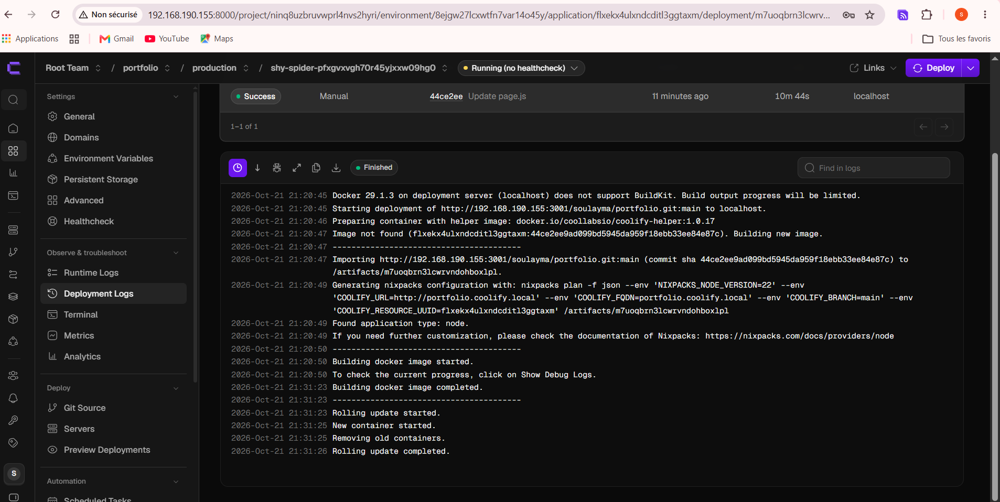

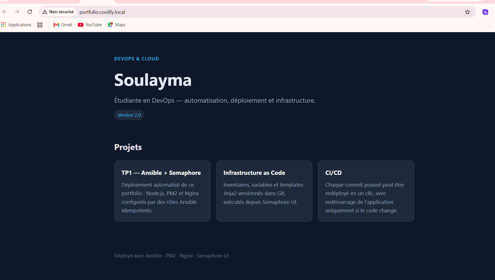

## Partie D — Redéploiement automatique (webhook Forgejo → Coolify)

**Côté Coolify** : Webhooks → Manual Git Webhooks → section **Gitea** (secret partagé) ; Auto Deploy activé.

**Côté Forgejo** : Paramètres → Webhooks → Ajouter un webhook → **Gitea**
- URL : `http://192.168.190.155:8000/webhooks/source/gitea/events/manual`
- Type de contenu : `application/json`, même secret que Coolify
- Événement : Push, filtre de branche `main`

Livraison réussie : réponse **200** `Deployment queued.`

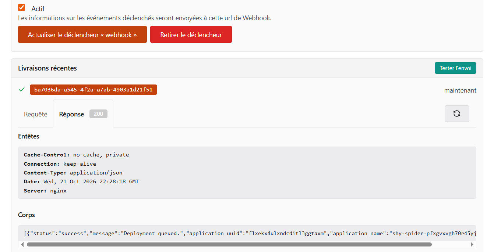

Après `git push forgejo main`, Coolify lance seul un déploiement (source **Webhook**) :

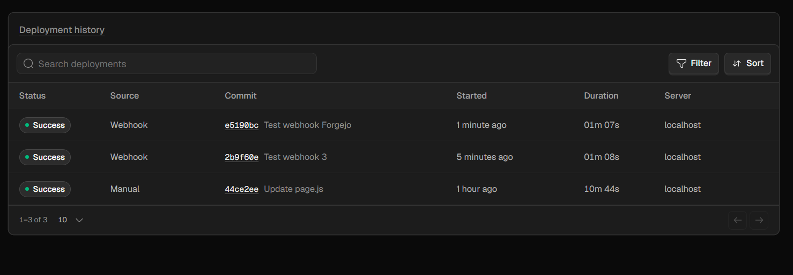

Le site affiche la modification (« Version 3.0 — Coolify ») :

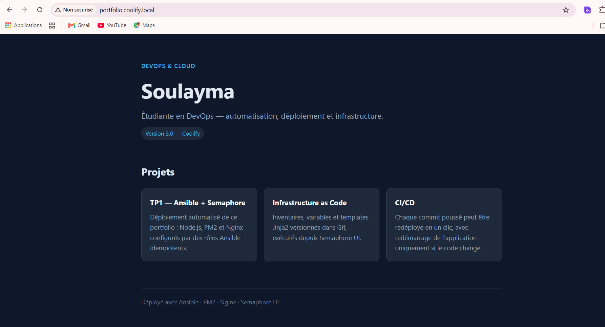

### Rollback et supervision

Un commit cassant volontairement le build (`Erreur volontaire`) fait échouer le déploiement automatique (**Failed**).
Coolify conserve le conteneur précédent : le site reste en ligne en version 3.0. Le dépôt est ensuite corrigé par un
nouveau commit qui restaure la version stable, et redéployé automatiquement.

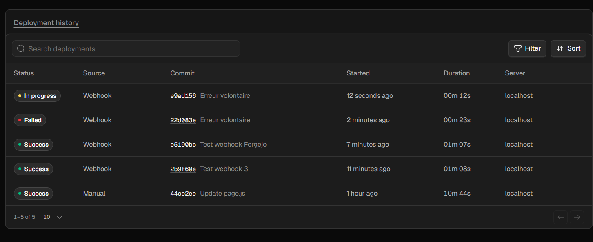

Supervision des ressources (`docker stats --no-stream`) :

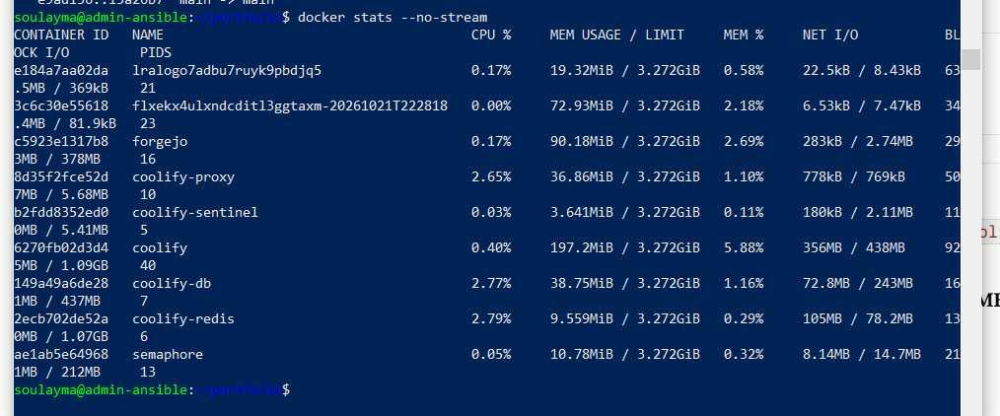

## Rapport

Tableau comparatif PaaS / IaC et difficultés rencontrées : [RAPPORT.md](RAPPORT.md)
